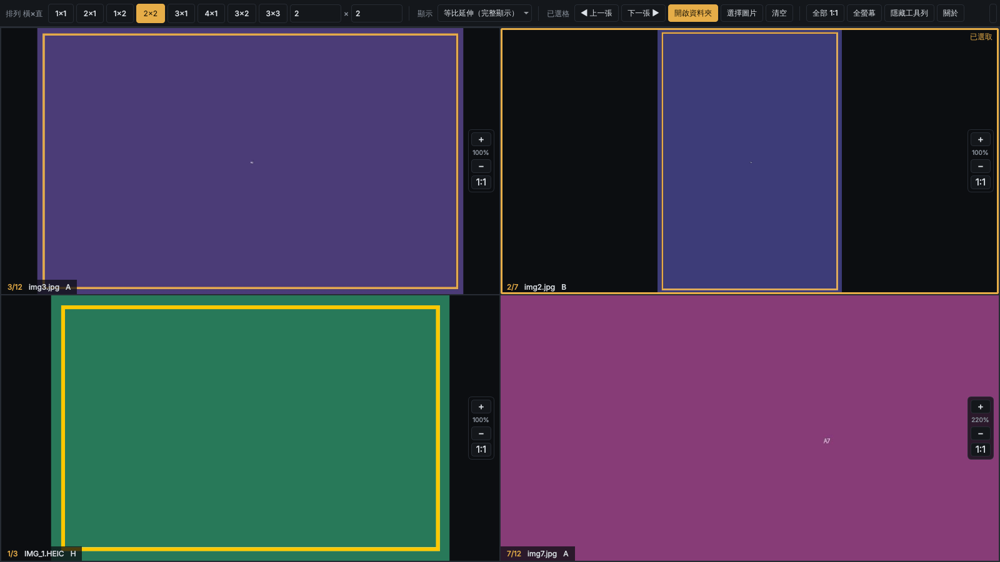
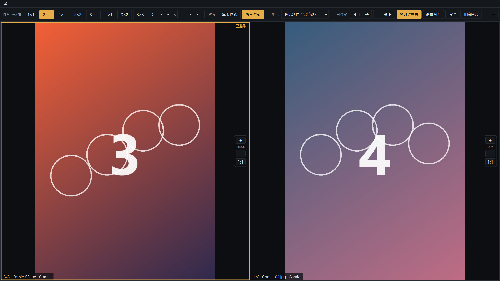

# 多格看圖器 MultiGrid Viewer



**漫畫模式**：所有格子連續翻頁，PageDown 一次換下一整頁



多格排列的離線看圖程式。自訂 橫×直 版面，每一格各自瀏覽一個資料夾、各自縮放平移，適合並排比對多張圖片。

A grid-based offline image viewer for side-by-side comparison. Each panel browses its own folder and keeps its own zoom.

**版本** 1.3.0 · 2026/10/18 · **製作人** Skypray Huang · **授權** MIT

## 下載

Windows 使用者請到 [Releases](https://github.com/skypray73/MultiGridViewer/releases/latest) 下載 `MultiGridViewer-Portable-v1.3.0.zip`，完整解壓縮後執行裡面的 `MultiGridViewer.exe`，不需安裝 Python。請保留同層 `_internal` 資料夾。
（執行檔未經簽章，Windows SmartScreen 可能出現警告，請按「其他資訊」→「仍要執行」。）

## 功能

- 版面：1×1、2×1、2×2、4×1、3×3… 或自訂 橫×直（最多 8×8）
- 拖「單張圖片」到某一格，自動載入同資料夾全部圖片並停在該張；拖「資料夾」則含子資料夾一起載入
- **圖片模式**：單張模式（每格各自瀏覽，點選一格後滾輪 / 方向鍵只換這一格）、漫畫模式（所有格共用同一資料夾或壓縮檔，選 2×1 時按 PageDown 就換成接下來的 2 張）
- **壓縮檔**：拖入 ZIP / RAR / 7Z（CBZ / CBR / CB7）自動讀取裡面的圖片，從第一張開始，上下鍵切換
- **刪除圖片**：按 Delete，先跳出確認視窗（滑鼠點選，或再按一次 Delete / Y 確認），圖片移到資源回收筒，並顯示下一張（沒有下一張就顯示上一張）
- 最上方「幫助」選單可查看完整使用說明（也可按 F1）
- 縮放控制列平常隱藏，滑鼠靠近各格右側邊緣時顯示，離開後自動收起
- 每格獨立縮放與平移，切換上下張時保留倍率與位置
- 預設等比延伸（不變形）；可改等比填滿或原始大小
- 支援 JPG、PNG、GIF、BMP、WebP、TIFF、HEIC / HEIF（iPhone 照片），依 EXIF 自動轉正
- 工具列可一鍵隱藏，支援全螢幕

## 安裝與執行

需要 Python 3.10 以上（建議 3.13，已測試）。

```bash
pip install -r requirements.txt
python multigrid_viewer.py [圖片或資料夾 ...]
```

Windows 可直接雙擊 `run_viewer.bat`（第一次會自動安裝套件）。

### 打包成 exe（Windows）

雙擊 `build_exe.bat`，完成後可攜 ZIP 位於 `dist\MultiGridViewer-Portable-v1.3.0.zip`，可複製到沒有 Python 的電腦使用。
對圖片按右鍵 →「開啟檔案」→ 選此 exe，即可設為預設看圖程式。

## 操作

| 動作 | 方式 |
|---|---|
| 選格 | 點一下某一格（金色框 = 已選取） |
| 上一張 / 下一張 | 單張模式：滾輪、← → ↑ ↓、PageUp / PageDown、空白鍵、工具列按鈕（只換已選格）。漫畫模式：← → ↑ ↓ 移動 1 張；滾輪、PageUp / PageDown、空白鍵翻整頁 |
| 第一張 / 最後一張 | Home / End（資料夾或壓縮檔的第一張 / 最後一張） |
| 刪除圖片 | Delete → 確認視窗：點按鈕，或再按一次 Delete（或 Y）確認；全程可只用鍵盤，也可 ← 選「刪除」後按 Enter。預設為「取消」，Esc 取消。刪除後顯示下一張，沒有下一張就顯示上一張；移到資源回收筒 |
| 切換模式 | 工具列「單張模式 / 漫畫模式」，或 `M` |
| 放大 / 縮小 | 滑鼠靠近每格右側邊緣顯示 ＋ / −、Ctrl+滾輪（以游標為中心）、鍵盤 + / - |
| 恢復原始填滿 | `/` 或 `0`（已選格）；`*`（全部格子）；或滑鼠靠近每格右側邊緣顯示 1:1 |
| 平移 | 按住左鍵拖曳；雙擊 = 放大 2 倍 / 還原 |
| 開啟 | 拖曳圖片 / 資料夾 / 壓縮檔到視窗、空白格雙擊、工具列「開啟資料夾」「選擇圖片」 |
| 隱藏工具列 | `H`；隱藏後按左上角 ☰ 叫回 |
| 全螢幕 | `F` 或 `F11`，`Esc` 離開 |
| 使用說明 | 最上方「幫助」選單，或 `F1` |

## Code signing policy

Free code signing provided by [SignPath.io](https://about.signpath.io/), certificate by [SignPath Foundation](https://signpath.org/).

- Committers and reviewers: [Skypray Huang](https://github.com/)
- Approvers: [Skypray Huang](https://github.com/)

Privacy policy: This program will not transfer any information to other networked systems. It only reads the image files and folders that the user opens.

## 壓縮檔支援

- ZIP / CBZ：內建支援。
- RAR / CBR、7Z / CB7：使用已安裝的 [7-Zip](https://www.7-zip.org)，沒有的話使用 Windows 10/11 內建的 `tar.exe`。有密碼保護的壓縮檔無法讀取。
- 壓縮檔會先解壓縮圖片到暫存資料夾，程式關閉時自動清除；不會修改原壓縮檔。

## 授權

本程式以 [MIT License](LICENSE) 釋出，Copyright © 2026 Skypray Huang。

使用之第三方元件：
[Qt for Python / PySide6](https://doc.qt.io/qtforpython/)（LGPL-3.0）、
[Pillow](https://python-pillow.org/)（MIT-CMU）、
[pillow-heif](https://github.com/bigcat88/pillow_heif)（BSD-3-Clause，內含 libheif 等函式庫，各自有其授權）。

## 1.2.0：影片模式與分離式 Portable ZIP

- 直接拖入影片會自動切換「影片模式」；或先選影片模式再開啟資料夾，載入其中的影片。
- 每格各自循環播放目前影片，播放結束後不會自動切換下一部。
- 預設保留長寬比例填滿分框，超出的邊緣會裁切；「顯示」可改為完整顯示。
- 工具列與右側邊緣浮出的控制可開始、暫停、上一部、下一部；空白鍵播放／暫停，PageUp 上一部、PageDown 下一部（影片模式的 ←／→ 改為前後 10 秒）。
- 每格聲音可獨立開關；載入新影片時只保留最新一部發聲，其他格可手動重新開啟，選格不改變聲音。
- 支援 MP4、MKV、MOV、WebM、AVI、M4V、WMV、MPEG、TS 等，實際支援依影片編碼而定。
- 圖片與漫畫模式保留原本的瀏覽、縮放、拖曳與刪除功能，切換模式會保留各格清單。
- Python、Qt、FFmpeg 解碼 DLL 和 HEIF 元件放在 `_internal`，主程式 EXE 不再內嵌大型依賴。無須額外下載 ffmpeg.exe。

```powershell
python build_portable.py
# 對已建置／簽章的資料夾重新產生 ZIP：
python build_portable.py --package-only
```

請散布完整 ZIP。第三方授權與版本資訊一起放在 ZIP 中；詳見 THIRD_PARTY_NOTICES.md。
### 啟動錯誤修正

1.2.0 的打包流程會檢查 QtCore 所需的 ICU 函式。若建置環境帶入同名但不相容的 `icuuc.dll`，會排除它及無其他使用者的 ICU 資料檔，改用 Windows 內建的相容 ICU，修正「DLL load failed while importing QtCore: 找不到指定的程序」。

打包後可執行離線診斷，實際載入 Qt、解碼影片、測試暫停／繼續，並輸出 JSON：

```powershell
MultiGridViewer.exe --verify-playback sample.mp4 result.json
```

## 1.3.0：獨立聲音與可拖曳時間軸

- 各分框右側浮出控制列都有 🔊／🔇 聲音按鈕；點擊即可各自開啟或靜音。
- 載入新影片時，預設只有最後載入的一部開聲，其他格靜音。可手動同時開啟多格聲音；選格、暫停、繼續、跳轉不會覆寫設定。
- 同一列播放工具列包含開始、暫停、上一部、下一部、後退／前進 10 秒、聲音切換、目前／總時間與可點擊／拖曳的時間軸，操作目前選取格。
- ← 後退 10 秒，→ 前進 10 秒；只在片頭／片尾範圍內跳轉，暫停時拖曳不會自動播放。
- PageUp 上一部、PageDown 下一部；影片模式不再用上下方向鍵或滾輪換片。空白鍵仍為播放／暫停。
- 保留等比填滿、單部循環、圖片／漫畫模式，以及 QtCore ICU 啟動修正。